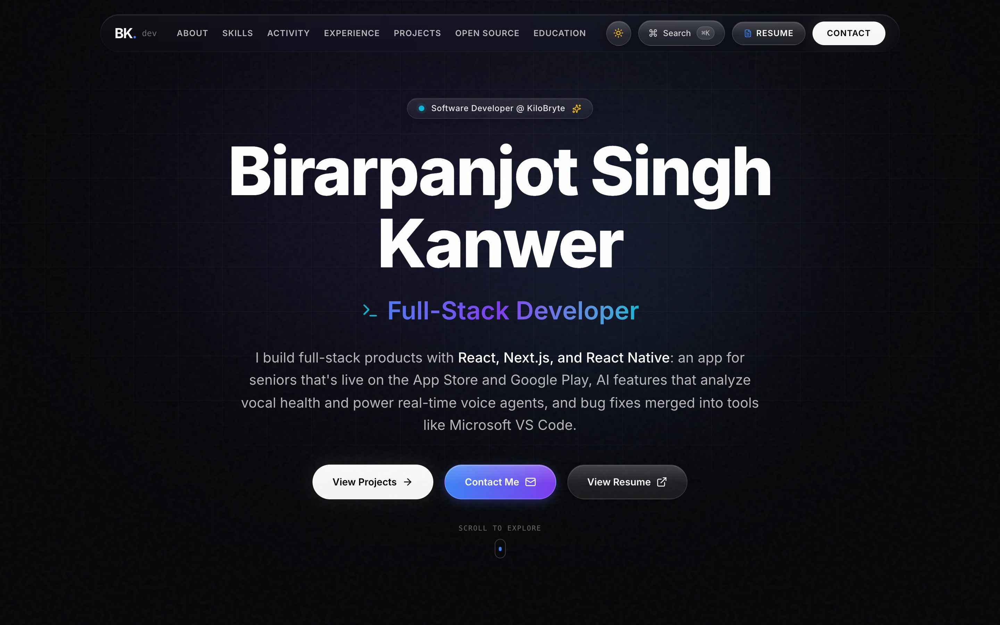
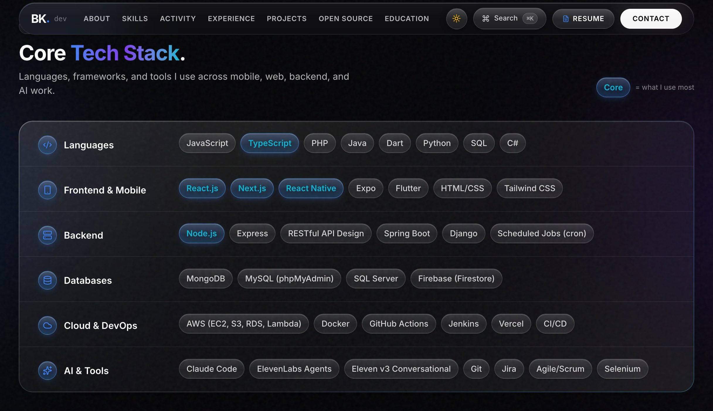
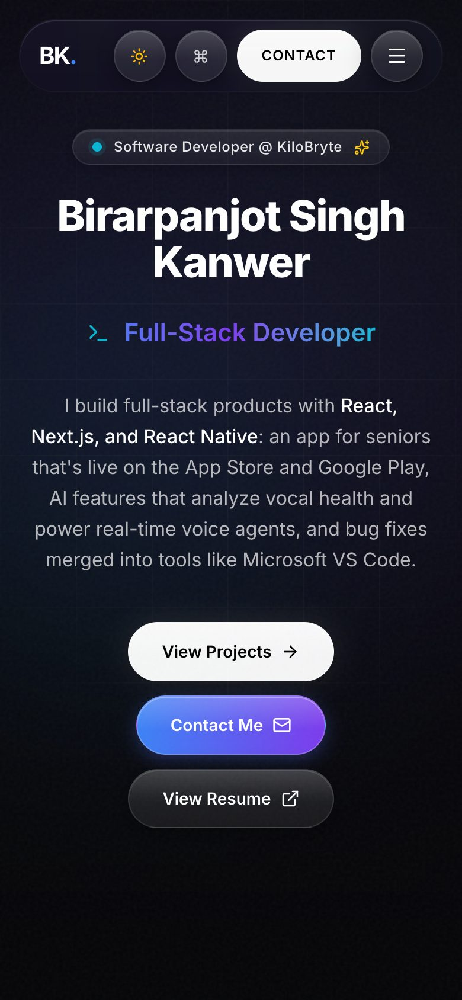
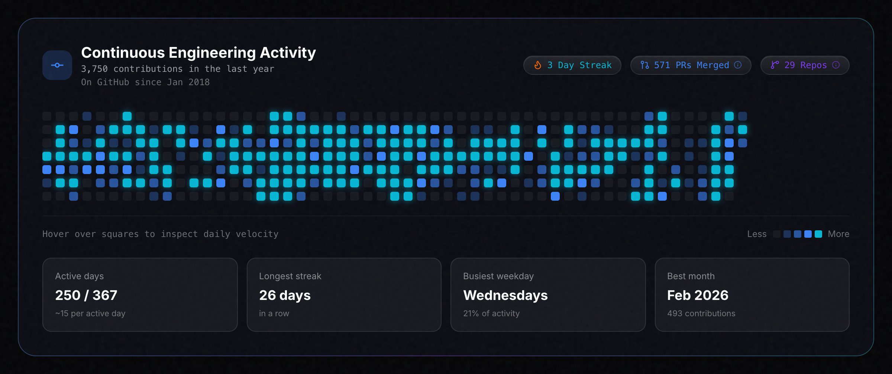

# Birarpanjot Singh Kanwer's Portfolio


Welcome to my portfolio! I'm Birarpanjot Singh Kanwer, a full-stack developer based in Ontario, Canada. I build full-stack products with React, Next.js and React Native: an app for seniors that's live on the App Store and Google Play, AI features that analyze vocal health and power real-time voice agents, and bug fixes merged into tools like Microsoft VS Code. I care about clean code and polished, user-friendly apps on both web and mobile.

[](https://arpankanwer.ai.studio)

**Live site: [arpankanwer.ai.studio](https://arpankanwer.ai.studio)**

## About Me

I'm a full-stack developer working across React Native apps, Next.js dashboards, Node.js and Firebase backends, and PHP/MySQL systems. At **KiloBryte** I build and maintain the Paige™ app for seniors, and integrated a voice AI model and longitudinal analysis to surface vocal health signals and trends over time. At **Evertz Microsystems** I automated 50+ Selenium tests, cutting regression testing time by 25%. As a Programming Tutor at **Sheridan College** I mentored 125+ students. In open source, I've had PRs merged in **Microsoft VS Code** and **oh-my-opencode-slim**.

I'm always looking for challenging projects that push me to learn and grow. My skills include:

- **Languages:** JavaScript, TypeScript, PHP, Java, Dart, Python, SQL, C#
- **Frontend & Mobile:** React.js, Next.js, React Native, Expo, Flutter, HTML/CSS, Tailwind CSS
- **Backend:** Node.js, Express, RESTful API Design, Spring Boot, Django, Scheduled Jobs (cron)
- **Databases:** MongoDB, MySQL (phpMyAdmin), SQL Server, Firebase (Firestore)
- **Cloud & DevOps:** AWS (EC2, S3, RDS, Lambda), Docker, GitHub Actions, Jenkins, Vercel, CI/CD
- **AI & Tools:** Claude Code, ElevenLabs Agents, Eleven v3 Conversational, Git, Jira, Agile/Scrum, Selenium

The ones I use most: **TypeScript, React.js, Next.js, React Native and Node.js**.

**At a glance:** 3+ years of experience · 50+ Selenium tests automated · merged PR in VS Code · Best Innovation 2024 (1st of 40+ teams) · 125+ students mentored · 3.52 GPA at Sheridan

## Experience

### Software Developer, KiloBryte
*Aug 2025 – Present · Guelph, ON*

- Build and maintain the Paige™ app, which keeps seniors in touch with family through one-touch video calls, using React Native, Expo, Next.js, Node.js and Firebase. It's live on the [App Store](https://apps.apple.com/ca/app/paige-connect/id6744338186) and [Google Play](https://play.google.com/store/apps/details?id=com.kilobryte.paigecompanion&hl=en_CA).
- Work on the native video bridging behind Paige's calls on iOS and Android.
- Integrated a voice AI model into our Next.js app to screen each recording for vocal health signals such as stress, fatigue and cognitive load, with an automated cron-job pipeline and a results dashboard.
- Integrated a longitudinal analysis API, so every user gets a baseline, per-recording deltas and a trend over time instead of one-off readings.

### Software QA Engineering Intern, Evertz Microsystems Ltd
*May 2024 – Aug 2024 · Burlington, ON*

- Automated 50+ Selenium end-to-end tests for Evertz's enterprise broadcast hardware and its web dashboards.
- Cut regression testing time by 25%, which sped up the release cadence for firmware builds.
- Worked with hardware and software teams to improve Smart Garden, an IoT plant-monitoring app.

### Programming Tutor, Sheridan College
*Jan–Apr 2023 · Sep–Dec 2023 · Oakville, ON*

- Mentored 125+ computer science students across two terms in programming fundamentals and frameworks including Spring Boot, AngularJS and Django.
- Ran weekly hands-on code reviews and debugging sessions, and wrote problem sets and architecture cheat sheets for advanced courses.

### Application Developer, Eduwings Global
*Apr 2021 – Nov 2021 · Ludhiana, Punjab, India*

- Built and published Eduwings' Android ERP app on Google Play, with a Flutter front end and PHP web services.
- Used Firebase for real-time data sync, user authentication and push announcements, and integrated payment gateways and a student document submission flow.

## Projects

Here are some of the projects I've worked on:

### Paige Connect: One-Touch Video Calling for Seniors

Paige keeps aging family members in touch through a one-touch video-calling frame. Paige Connect is its companion app: family members and frame admins use it to set up the frame, manage who can call it, and make and receive calls. I build and maintain it at KiloBryte, including the voice AI integration that analyzes recordings for vocal health signals.

- **Technologies Used:** React Native, Expo, Next.js, Node.js, Firebase, native video bridging
- **Links:** [App Store](https://apps.apple.com/ca/app/paige-connect/id6744338186) · [Google Play](https://play.google.com/store/apps/details?id=com.kilobryte.paigecompanion&hl=en_CA)

### Skillkoo / Eduwings: Education Platform with AI Career-Counseling Voice Agents

An education platform on iOS, Android and the web that helps students plan their careers and studies. Students build a profile, upload documents securely, get guidance on countries and programs for studying abroad, and talk through their options with real-time AI career-counseling voice agents.

- **Technologies Used:** React Native, Expo, Express.js, AWS S3, ElevenLabs Agents, Eleven v3 Conversational
- **Links:** [App Store](https://apps.apple.com/us/app/skillkoo/id6761086381) · [Google Play](https://play.google.com/store/apps/details?id=com.eduwings.global&hl=en_CA) · [Website](https://www.learn.skillkoo.com/)

### GigJet: On-Demand Service Marketplace with Real-Time Chat

🏆 **Best Innovation 2024** at Sheridan College, ranking 1st among 40+ teams.

A full-stack mobile marketplace that connects people who need local services with the providers who offer them. Seekers post jobs with a location, providers respond with quotes, and both sides work it out through real-time in-app chat.

- **Technologies Used:** React Native, Expo, Node.js, Express, Firebase, REST API
- **Links:** [Pitch Video on YouTube](https://youtu.be/M1adKEKeFLo) · [Figma Designs](https://www.figma.com/design/czmfCp4NJjOQn1y6MknLjz/Capstone?node-id=0-1&t=mgfBlIu44I6F7Afq-1)

### Portfolio Website

This site. It presents my experience, projects and open-source work, and pulls my GitHub contribution activity live. See [About This Website](#about-this-website) below.

- **Technologies Used:** Next.js, React, TypeScript, Tailwind CSS, Framer Motion, GitHub GraphQL API
- **Links:** [Website](https://arpankanwer.ai.studio/) · [GitHub Repository](https://github.com/arpankanwer/portfolio)

### Smart Garden (IoT)

A team project at Evertz Microsystems. A raised garden bed is divided into zones, each watered through motorized valves controlled by a microcontroller, and the system is operated from an internally hosted website. During my internship I collaborated across teams to improve it.

- **Technologies Used:** IoT, microcontroller firmware (C/C++), JavaScript, Python
- **GitHub Repository:** [Smart Garden](https://github.com/Evertz-Garden/SmartGarden/tree/WebUIChange)

### Chatie

A real-time group chat app in the spirit of Telegram. Users create or search for groups, send messages and file attachments, and group admins manage members.

- **Technologies Used:** Flutter, Dart, Firebase Auth, Cloud Firestore, Firebase Storage
- **Links:** [Website](https://chatie1.web.app/) · [GitHub Repository](https://github.com/arpankanwer/chatie)

## Open Source Contributions

- **[Microsoft VS Code](https://github.com/microsoft/vscode)**, merged ([PR #334129](https://github.com/microsoft/vscode/pull/334129), Sep 2026): once a pasted image expired, Copilot Chat got stuck failing every later request with a 400 error and retrying the same broken payload. I stopped the retries for that error, replaced them with a clear message telling users to remove the image or start a new chat, and added regression tests.
- **[OpenUsage](https://github.com/robinebers/openusage)**, co-authored ([PR #1323](https://github.com/robinebers/openusage/pull/1323), Sep 2026): after the OpenCode 2 upgrade, its OpenCode card stopped reporting spend correctly and missed Go logins. In [PR #1243](https://github.com/robinebers/openusage/pull/1243) I traced it to OpenCode 2's new `session_message` table and credential store, and the maintainers merged the fix in #1323 with me as co-author.
- **[oh-my-opencode-slim](https://github.com/alvinunreal/oh-my-opencode-slim)**, merged ([PR #1058](https://github.com/alvinunreal/oh-my-opencode-slim/pull/1058), Aug 2026): on the OpenCode v2 beta the plugin failed to load at all, because v2 expects a different plugin shape. I shipped a dual-contract TUI module that works with both v1 and v2, with tests covering both.

## Education & Awards

- **Sheridan College**, Oakville, ON: Advanced Diploma in Computer Systems Technology, specializing in Software Development & Network Engineering (Jan 2022 – Dec 2024). Cumulative GPA 3.52 / 4.0.
- **Best Innovation Award 2024**, Sheridan College Software Engineering Capstone Showcase: top rank among 40+ competing teams for building GigJet.

## About This Website

| Tech Stack section | On a phone |
| --- | --- |
|  |  |



It's a single page: Hero, About, Tech Stack, GitHub Activity, Experience, Projects, Open Source, Education and Contact. It has a ⌘K command palette, light and dark themes, and a "liquid glass" look that's tuned to stay smooth on phones, iOS included.

### Tech stack

- **Next.js 16** (App Router, Turbopack), **React 19**, **TypeScript**
- **Tailwind CSS v4**, plus a custom liquid-glass utility layer in `app/globals.css`
- **Framer Motion** for section entrances, the hero parallax and the rotating hero title
- **Lenis** for smooth wheel scrolling (touch scrolling keeps native momentum)
- **cmdk** for the command palette, **lucide-react** for icons
- **react-hook-form** and **zod** for the contact form

### Integrations

**Live GitHub activity (GitHub GraphQL API).** The Activity section ("Continuous Engineering Activity") gets its data from `app/api/github/route.ts`. That route calls GitHub's GraphQL API through `lib/github.ts` for the last year's contribution calendar and the account's creation date, and works out the current and longest streaks.

- **Caching:** responses are cached in memory for an hour. If a refresh fails, the last good response keeps being served.
- **Always fresh:** the route is `force-dynamic`, so a snapshot taken at build time can't go stale on hosts that scale to zero.
- **Year-in-review tiles:** active days, longest streak, busiest weekday and best month are calculated in the browser from the same calendar, so they cost no extra requests.
- **No made-up numbers:** while loading, the section shows a skeleton. If GitHub can't be reached, it says so and links to the GitHub profile.
- **PR and repo totals are a dated snapshot.** Most merged PRs are in private repos, many of them at work, and counting those live would need a token that can read private code. Instead, `npm run github:snapshot` uses your local GitHub CLI login to write `lib/github-snapshot.json` (merged PRs and owned repos, public and private, plus the date). The chips show the totals, and hovering or tapping one shows the public/private split and the snapshot date. See [docs/github-snapshot.md](docs/github-snapshot.md).

The totals come from GitHub's API, which can be a few contributions lower than the number on the GitHub profile page.

**Hosting on Google AI Studio.** The site is built and deployed with Google AI Studio, which runs it on Cloud Run.

- `output: 'standalone'` in `next.config.ts` produces the self-contained Node server that Cloud Run runs.
- `metadata.json` and `assets/.aistudio/` are AI Studio's project files. Leave them in place.
- Secrets such as `GITHUB_TOKEN` are set in AI Studio's Secrets panel and injected at runtime.
- AI Studio sets `DISABLE_HMR=true` to turn off file watching while it edits code.

**Command palette.** Open it with ⌘K, Ctrl+K or the navbar button. From there you can jump to any section, open the resume, GitHub or LinkedIn, or copy the email address.

**Contact form.** The form is validated with react-hook-form and zod. On submit, it opens the visitor's email app with the message filled in (`mailto:`), so there's no backend or third-party form service. The email address and phone number each have a copy button.

**Theming.** The site is dark by default, with an optional light theme. The choice is saved in `localStorage` under `bk_portfolio_theme`. An inline script in `app/layout.tsx` applies it before the first paint, so returning light-mode visitors don't see a dark flash.

### Getting started

```bash
npm install
cp .env.example .env.local   # fill in GITHUB_TOKEN and GITHUB_USERNAME
npm run dev
```

Then open http://localhost:3000.

| Variable | Used by | Notes |
| --- | --- | --- |
| `GITHUB_TOKEN` | Activity section | Only needs `read:user`; don't give it `repo`. Private contributions still appear as counts when "Include private contributions on my profile" is on in your GitHub settings. |
| `GITHUB_USERNAME` | Activity section | Defaults to `arpankanwer`. |
| `GEMINI_API_KEY`, `APP_URL` | (none) | AI Studio injects these. The code doesn't use them today. |

Without `GITHUB_TOKEN` the site still runs, and the Activity section shows its "unavailable" state.

| Command | What it does |
| --- | --- |
| `npm run dev` | Dev server with hot reload |
| `npm run build` | Production build (standalone output) |
| `npm run start` | Serves the production build |
| `npm run lint` | ESLint |
| `npm run github:snapshot` | Refreshes the PR and repo totals in `lib/github-snapshot.json` (needs `gh auth login`; see [docs/github-snapshot.md](docs/github-snapshot.md)) |

**Testing on a phone.** Run `npx next dev --hostname 0.0.0.0` and open `http://<your-computer's-LAN-IP>:3000` on a phone on the same Wi-Fi. `allowedDevOrigins` in `next.config.ts` lets `10.0.0.*` addresses use hot reload; add your own network's range if it's different. Dev mode feels heavier than the real site, so for performance checks run `npm run build && npx next start --hostname 0.0.0.0 --port 3001`. Next warns that standalone output is meant to run with `node .next/standalone/server.js`, but `next start` is fine for local testing.

### Project structure

```
app/
  layout.tsx                   fonts, metadata, theme script, global providers
  page.tsx                     section order
  globals.css                  theme tokens and the liquid-glass utilities
  api/github/route.ts          cached GitHub data endpoint
components/                    one file per section, plus Navbar, CommandPalette,
                               ThemeProvider, SmoothScroll, CustomCursor and Footer
lib/github.ts                  GitHub GraphQL query, contribution levels, streaks
lib/github-snapshot.json       dated PR and repo totals (public and private)
scripts/github-snapshot.mjs    refreshes the snapshot with the GitHub CLI
docs/                          snapshot how-to, README photo and screenshots
public/                        project images, icons, web manifest
```

### Notes

- **No `backdrop-filter` on the liquid-glass classes.** Tailwind v4's CSS compiler reduced each `backdrop-filter` / `-webkit-backdrop-filter` pair to the `-webkit-` form only. Chrome never blurred those elements, while iOS Safari blurred more than a hundred of them on every scroll frame. The glass look comes from translucent fills, gradients and highlights. Real blur is kept to the Tailwind `backdrop-blur-*` utilities on the navbar, cards and overlays.
- **Touch targets:** on touch screens, interactive glass buttons are at least 44×44px. Static chips and badges are excluded.

## Contact Me

I'm always interested in new opportunities and collaborations. Feel free to reach out to me through the following channels:

- **Email:** [birarpanjot@gmail.com](mailto:birarpanjot@gmail.com)
- **LinkedIn:** [Birarpanjot Singh Kanwer](https://www.linkedin.com/in/arpankanwer)
- **GitHub:** [arpankanwer](https://github.com/arpankanwer)
- **Personal Website:** [arpankanwer.ai.studio](https://arpankanwer.ai.studio)
- **Resume:** [View on Google Drive](https://drive.google.com/file/d/1rzbi-38XBH-C3YE_Fyy9Zqeu8jqtrkhv/view?usp=sharing)

Let's connect and create something amazing together!
